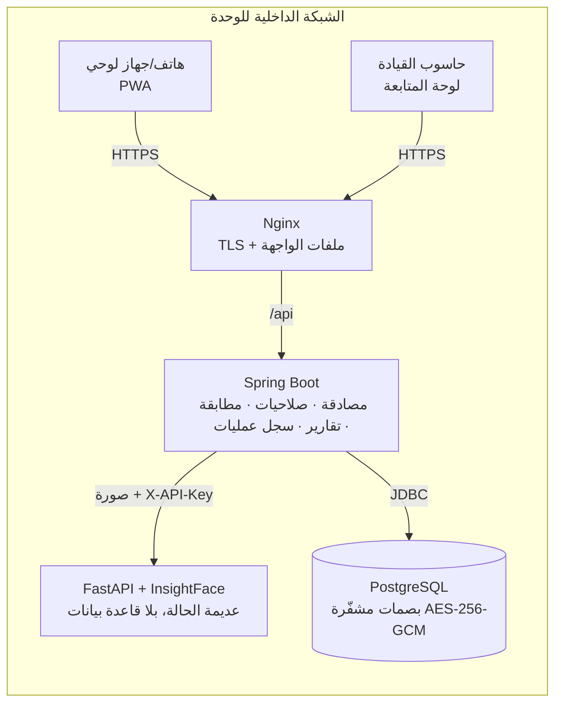

# النظام العسكري الذكي لإدارة الحضور والانضباط
**Military Smart Attendance and Discipline System**

منصة تستبدل النداء على الأسماء في الطابور بصورة واحدة: تكتشف كل الوجوه، وتطابقها مع جنود الفصيل، وتسجّل الحضور تلقائياً، مع بقاء التحضير اليدوي متاحاً دائماً، وآلية اعتماد لقائد الفصيل، وتقارير PDF وExcel، وسجل عمليات لا يمكن تعديله. كل شيء يعمل على سيرفر داخلي دون أي خدمة سحابية.

| المكوّن | التقنية | المجلد |
|---|---|---|
| الخادم الرئيسي | Java 17 · Spring Boot 3.3 · Spring Security · JPA · Flyway | `backend/` |
| خدمة التعرف على الوجوه | Python · FastAPI · InsightFace (SCRFD + ArcFace) · ONNX Runtime (CPU) | `face-service/` |
| قاعدة البيانات | PostgreSQL 16 | `backend/src/main/resources/db/migration` |
| الواجهة | Angular 19 · تطبيق ويب تقدّمي (PWA) · عربي RTL + إنجليزي | `frontend/` |
| التشغيل | Docker Compose · Nginx (HTTPS) · GitHub Actions | الجذر |

> **التحليل الكامل للمتطلبات، والخطة، والتحسينات المضافة، والافتراضات:** [`docs/ANALYSIS.md`](docs/ANALYSIS.md)
> **تحمّل الضغط (5000+ مستخدم) والإعدادات والاختبار بـ k6:** [`docs/SCALING.md`](docs/SCALING.md)
> **نتائج الاختبارات بالتفصيل (ما نجح وما لم يُشغَّل ولماذا):** [`docs/TEST-RESULTS.md`](docs/TEST-RESULTS.md)

---

## 1. التشغيل السريع (Docker)

المتطلبات: Docker 24+ وDocker Compose، وسيرفر بمعالج 4 أنوية على الأقل (8 موصى بها) وذاكرة 8GB.

```bash
cp .env.example .env
# املأ الأسرار (أمثلة الأوامر داخل الملف):
#   JWT_SECRET=$(openssl rand -base64 48)
#   BIOMETRIC_ENC_KEY=$(openssl rand -base64 32)
#   FACE_API_KEY=$(openssl rand -hex 24)   DB_PASSWORD=$(openssl rand -hex 24)
# للتجربة: DEMO_DATA_ENABLED=true و DEMO_PASSWORD=<10 أحرف أو أكثر>
# للإنتاج:  BOOTSTRAP_ADMIN_PASSWORD=<12 حرفاً أو أكثر> ويُطلب تغييرها عند أول دخول
docker compose up -d --build
```

ثم افتح `https://<عنوان-السيرفر>:8443`. يولّد Nginx شهادة ذاتية التوقيع عند أول تشغيل إذا لم تضع شهادتك في `certs/server.crt` و`certs/server.key`. **الكاميرا في الهواتف لا تعمل إلا عبر HTTPS**، لذا استخدم شهادة من الجهة الداخلية المعتمدة في التشغيل الفعلي.

> صورة خدمة الوجوه تنزّل نماذج InsightFace أثناء البناء (من GitHub)، ثم تعمل بلا إنترنت. إن كان السيرفر معزولاً تماماً، ابنِ الصورة على جهاز متصل ثم انقلها بـ `docker save` / `docker load`.

### حسابات البيانات الأولية للتجربة (عند `DEMO_DATA_ENABLED=true` فقط)
كلها بكلمة المرور الموجودة في `DEMO_PASSWORD` (لا توجد كلمات مرور داخل الكود):

| المستخدم | الدور | الفصيل |
|---|---|---|
| `agent` | وكيل السرية | الكل |
| `general` | السنير العام | الكل (متابعة) |
| `leader1` / `leader2` | قائد الفصيل | الأول / الثاني |
| `senior1` / `senior2` / `senior3` | السنير | الأول / الثاني / الثالث |

تُنشأ 3 فصائل و36 جندياً بأسماء خيالية. **لا تُفعّل البيانات التجريبية في الإنتاج.**

### الصور الشخصية
- من صفحة الجندي: اختيار صورة من الجهاز أو التقاطها بالكاميرا، مع خيار «تسجيل الوجه للتعرف من هذه الصورة أيضاً». المستخدمون (وكيل السرية فقط لغيره، وكل مستخدم لنفسه من «الإعدادات») يضيفون صورتهم.
- تُقصّ الصورة حول الوجه وتُصغَّر إلى 384px وتُشفَّر (AES-256-GCM) في القاعدة ولا يُحفظ الأصل.
- **صور الكاميرا أثناء التحضير لا تُحفظ إطلاقاً**؛ تُستخدم للمطابقة ثم تُتلف.
- صور المستخدمين للعرض فقط (لا دخول بالوجه). تُحذف صورة الجندي عند إنهاء خدمته.

### الضغط العالي
يعمل الخادم بنسختين افتراضياً خلف Nginx (`BACKEND_REPLICAS` في `.env`؛ اجعلها `1` على حاسوب ضعيف). التفاصيل والتقديرات وكيفية القياس: [`docs/SCALING.md`](docs/SCALING.md).

## 2. التشغيل للتطوير (بدون Docker)

```bash
# 1) قاعدة البيانات
createdb attendance

# 2) خدمة الوجوه
cd face-service && python3.11 -m venv .venv && . .venv/bin/activate
pip install -r requirements-dev.txt
FACE_API_KEY=dev-face-key-0123456789 uvicorn app.main:app --port 8000

# 3) الخادم الرئيسي
cd backend
DB_USER=postgres DB_PASSWORD=... JWT_SECRET=dev-secret-at-least-32-bytes-long-000 \
BIOMETRIC_ENC_KEY=$(openssl rand -base64 32) FACE_API_KEY=dev-face-key-0123456789 \
REFRESH_COOKIE_SECURE=false DEMO_DATA_ENABLED=true DEMO_PASSWORD=Demo-Pass-2026 \
mvn spring-boot:run          # http://localhost:8080 — توثيق الواجهات: /swagger-ui.html

# 4) الواجهة
cd frontend && npm ci && npx ng serve    # http://localhost:4200 (يمرّر /api إلى 8080)
```

على `localhost` تعمل الكاميرا دون HTTPS. من هاتف على الشبكة نفسها تحتاج HTTPS.

## 3. الاختبارات

```bash
cd face-service && FACE_RUN_MODEL_TESTS=1 pytest -q           # 14 اختباراً (منها 3 على النموذج الحقيقي)
cd backend && TEST_DB_URL=jdbc:postgresql://localhost:5432/attendance_test mvn verify
cd frontend && npx ng build && npx ng test --watch=false
```
ملف `.github/workflows/ci.yml` يشغّل الثلاثة تلقائياً على GitHub مع PostgreSQL حقيقي.

## 4. هيكل المشروع

```
military-attendance/
├── docker-compose.yml · .env.example · .github/workflows/ci.yml
├── docs/  ANALYSIS.md · SCALING.md · TEST-RESULTS.md · screenshots/
├── loadtest/  k6-tahiya.js (اختبار الحمل)
├── face-service/                  خدمة عديمة الحالة: صورة ← وجوه + بصمات
│   ├── app/ main.py (API) · engine.py (SCRFD/ArcFace) · imaging.py (تحقق الصور) · config.py
│   └── tests/ test_api.py · test_imaging.py · test_real_model.py
├── backend/
│   └── src/main/java/om/mtc/attendance/
│       ├── config/      الأمان، CORS، الإعدادات، التحقق من الأسرار عند الإقلاع
│       ├── security/    JWT، فلتر المصادقة، الحد من محاولات الدخول
│       ├── domain/      الكيانات والتعدادات
│       ├── repository/  استعلامات Spring Data
│       ├── service/     منطق الأعمال: الصلاحيات، المطابقة، التشفير، الجلسات، التقارير، التصدير
│       ├── web/         وحدات التحكم REST + DTO + معالجة الأخطاء
│       └── bootstrap/   أول مدير، البيانات التجريبية
│       └── resources/db/migration/V1__init_schema.sql
└── frontend/src/app/
    ├── core/     المصادقة، المعترض، الحراس، الترجمة، الشبكة والطابور دون اتصال
    ├── shared/   الكاميرا، الأيقونات، الشارات، نافذة التأكيد
    ├── layout/   الهيكل: قائمة جانبية للحاسوب وشريط سفلي للهاتف
    └── pages/    16 صفحة (انظر القسم 7)
```

## 5. بنية النظام



- **المطابقة تتم في الخادم الرئيسي** حيث توجد البيانات؛ خدمة الوجوه لا ترى أسماء ولا قاعدة بيانات، ويمكن تشغيل أكثر من نسخة منها أو نقلها إلى سيرفر GPU دون تغيير أي شيء آخر.
- **الصور لا تُحفظ أبداً**: تمر في الذاكرة ثم تُهمل. يُخزَّن فقط تمثيل رقمي مشفّر (512 رقماً) لكل صورة تسجيل.
- **المطابقة**: تشابه جيب التمام مع كل قوالب جنود فصيل الجلسة فقط، ثم تعيين شامل «واحد لواحد» (أعلى الأزواج أولاً) حتى لا يُحتسب جندي مرتين ولا يأخذ وجهان الجندي نفسه.

## 6. قاعدة البيانات (ERD)

```mermaid
erDiagram
  platoon ||--o{ soldier : "يضم"
  platoon ||--o{ attendance_session : "له"
  platoon ||--o{ app_user : "مرتبط (السنير/القائد)"
  soldier ||--o{ face_embedding : "بصمات مشفّرة"
  attendance_session ||--o{ attendance_record : "سجل لكل جندي"
  soldier ||--o{ attendance_record : ""
  app_user ||--o{ refresh_token : "جلسات الدخول"
  platoon { bigint id PK; varchar code UK; varchar name; bool active }
  soldier { bigint id PK; varchar military_number UK; varchar full_name; varchar military_rank; bool active; bool biometric_consent }
  face_embedding { bigint id PK; bytea embedding_enc; varchar model_name; real det_score }
  attendance_session { bigint id PK; varchar session_type; date session_date; timestamptz scheduled_at; varchar status; bigint version }
  attendance_record { bigint id PK; varchar status; varchar method; real similarity; varchar note }
  app_user { bigint id PK; varchar username UK; varchar password_hash; varchar role; int failed_attempts; timestamptz locked_until }
  audit_log { bigint id PK; timestamptz occurred_at; varchar action; varchar details; varchar ip_address; bool success }
  system_setting { varchar setting_key PK; varchar setting_value }
```

قيود مهمة على مستوى قاعدة البيانات: سجل واحد فقط لكل جندي في كل جلسة `UNIQUE(session_id, soldier_id)`، وجلسة مفتوحة واحدة فقط لكل فصيل (فهرس جزئي فريد)، والسنير وقائد الفصيل لا يُنشآن دون فصيل (CHECK)، و`audit_log` **لا يقبل التعديل أبداً ولا الحذف قبل 365 يوماً** (Trigger)، وقفل تفاؤلي على الجلسة لمنع إغلاقها من جهازين في اللحظة نفسها.

## 7. الواجهات

| الصفحة | المسار | الأدوار |
|---|---|---|
| تسجيل الدخول / تغيير كلمة المرور | `/login` `/change-password` | الجميع |
| الرئيسية (فصيلي، بدء تحضير، آخر جلسة) | `/home` | السنير، قائد الفصيل |
| لوحة المتابعة المباشرة (تحديث كل 30 ثانية) | `/dashboard` | السنير العام، وكيل السرية، قائد الفصيل (فصيله) |
| جلسات التحضير (تصفية بالفصيل والحالة والتاريخ) | `/sessions` | الجميع حسب النطاق |
| فتح جلسة | `/sessions/new` | السنير، قائد الفصيل، وكيل السرية |
| الجلسة: كاميرا + نتيجة بإطارات الوجوه + الكشف اليدوي + الإغلاق + الاعتماد | `/sessions/:id` | حسب الدور |
| الاعتمادات المنتظرة | `/approvals` | قائد الفصيل، وكيل السرية |
| الجنود (بحث، تصفية، فرز) وبطاقة الجندي مع تسجيل الوجه | `/soldiers` `/soldiers/:id` | عرض للجميع، إدارة للقائد والوكيل |
| الفصائل | `/platoons` | وكيل السرية (إدارة)، السنير العام (عرض) |
| التقارير اليومية والشهرية + تصدير PDF/Excel | `/reports` | السنير العام، القائد (فصيله)، الوكيل |
| المستخدمون والأدوار | `/users` | وكيل السرية |
| سجل العمليات | `/audit` | وكيل السرية |
| الإعدادات (حسابي + عتبة التعرف وغيرها) | `/settings` | الجميع (التعديل للوكيل) |

صور فعلية للواجهات في [`docs/screenshots/`](docs/screenshots). الحالات الخاصة مغطاة: رسالة لكل خطأ قادم من الخادم، حالات فارغة، شريط «لا يوجد اتصال» مع حفظ التحضير اليدوي وإرساله عند عودة الشبكة، وتحويل تلقائي إلى التحضير اليدوي إذا تعطلت خدمة التعرف.

## 8. واجهات REST

كل المسارات تحت `/api` وتتطلب `Authorization: Bearer <token>` ما عدا الدخول والتحديث والخروج. التوثيق التفاعلي الكامل: `/swagger-ui.html` (معطّل في ملف `prod`).

| Method | Endpoint | الوظيفة |
|---|---|---|
| POST | `/api/auth/login` · `/refresh` · `/logout` | الدخول، تجديد الرمز من كوكي HttpOnly، الخروج |
| GET/POST | `/api/auth/me` · `/api/auth/change-password` | بيانات المستخدم، تغيير كلمة المرور |
| GET/POST/PUT | `/api/platoons` · `/{id}` | الفصائل |
| GET/POST | `/api/soldiers?platoonId&active&q&page&size&sort&dir` | بحث وإضافة |
| GET/PUT | `/api/soldiers/{id}` | عرض وتعديل (والموافقة البيومترية) |
| POST | `/api/soldiers/{id}/deactivate` · `/reactivate` | إنهاء الخدمة (يحذف البصمات فوراً) |
| GET/POST/DELETE | `/api/soldiers/{id}/faces` | قوالب الوجه: عرض، تسجيل صورة، حذف |
| GET/POST | `/api/sessions` · `/api/sessions/open?platoonId` | قائمة الجلسات، فتح جلسة |
| GET | `/api/sessions/{id}` | الكشف والأعداد |
| POST | `/api/sessions/{id}/recognize` | التحضير بالكاميرا (فردية أو جماعية) |
| POST | `/api/sessions/{id}/manual` | التحضير اليدوي مع ملاحظة |
| POST | `/api/sessions/{id}/close` | الإغلاق واحتساب الغياب |
| POST | `/api/sessions/{id}/approve` | اعتماد قائد الفصيل مع التعديلات |
| GET | `/api/dashboard/live` · `/api/dashboard/trend?days=7` | المتابعة المباشرة والاتجاه |
| GET | `/api/reports/daily` · `/monthly` · `/…/export?format=pdf\|xlsx` | التقارير والتصدير |
| GET/POST/PUT | `/api/users` · `/{id}/reset-password` · `/{id}/unlock` | المستخدمون |
| GET | `/api/audit` | سجل العمليات |
| GET/PUT | `/api/settings` | إعدادات النظام |
| POST | `face-service: /embed` · GET `/health` | اكتشاف الوجوه وإعادة البصمات |

شكل الأخطاء موحّد: `{ "code": "SESSION_NOT_OPEN", "message": "…", "fieldErrors": {…} }`.

## 9. الأمان وحماية البيانات

- **كلمات المرور**: BCrypt (cost 12)، سياسة 10 أحرف بحروف وأرقام، كلمة مؤقتة إجبارية التغيير عند أول دخول.
- **الجلسات**: رمز وصول JWT قصير (30 دقيقة) في الذاكرة فقط، ورمز تجديد عشوائي مخزّن بـ SHA-256، يُستعمل مرة واحدة، في كوكي `HttpOnly; Secure; SameSite=Strict` محصور في `/api/auth`. إعادة استعمال رمز ملغى تُلغي كل جلسات المستخدم. تغيير كلمة المرور أو تعطيل الحساب يُبطل الرموز فوراً لأن المستخدم يُعاد تحميله من قاعدة البيانات في كل طلب.
- **محاولات الدخول**: قفل الحساب 15 دقيقة بعد 5 محاولات، وحد 20 محاولة/دقيقة لكل IP، ورسالة موحّدة لا تكشف وجود الاسم.
- **الصلاحيات على الخادم**: مصفوفة جدول 3 مطبّقة في `AccessPolicy` و`@PreAuthorize`، والنطاق (فصيل المستخدم) داخل الاستعلامات نفسها.
- **البيومترية**: موافقة مسجّلة (من ومتى) قبل أي تسجيل وجه، تشفير AES-256-GCM مع ربط القالب برقم الجندي، حذف فوري عند سحب الموافقة أو إنهاء الخدمة، لا صور مخزّنة، رفض الوجه إن كان مسجّلاً لجندي آخر.
- **المدخلات**: Bean Validation، استعلامات معاملات (لا SQL مركّب يدوياً)، فحص توقيع الملف (JPEG/PNG/WebP) وحجمه ودقته في الخادم وفي خدمة الوجوه.
- **النقل والرؤوس**: HTTPS عبر Nginx مع HSTS وCSP و`X-Frame-Options` و`Permissions-Policy` (الكاميرا للموقع نفسه فقط)، وخدمة الوجوه محمية بمفتاح API ولا تُكشف خارج شبكة Docker.
- **السجلات**: سجل عمليات لكل إضافة وتعديل وتعرّف واعتماد وتصدير ودخول، بلا أسرار أو بصمات، وغير قابل للتعديل على مستوى قاعدة البيانات.
- **الأسرار**: لا شيء داخل الكود؛ الخادم يرفض الإقلاع إذا كان أي سر ناقصاً أو ضعيفاً.

## 10. التجهيز لبيئة الإنتاج

1. الحصول على موافقة الجهة المسؤولة وسياسة الاحتفاظ بالبيانات، ومراجعة الالتزام بقانون حماية البيانات الشخصية (المرسوم السلطاني 6/2022).
2. **ترخيص النموذج**: نماذج InsightFace الجاهزة مرخّصة للاستخدام البحثي غير التجاري؛ احصل على ترخيص تجاري أو بدّل النموذج قبل التشغيل الرسمي.
3. شهادة TLS من الجهة الداخلية في `certs/`، وأسرار قوية فريدة في `.env`، و`DEMO_DATA_ENABLED=false`.
4. تشفير القرص للسيرفر، ونسخ احتياطي مشفّر يومي: `docker compose exec db pg_dump -U attendance attendance | gpg -c > backup.sql.gpg`.
5. جهاز UPS، وتقييد الوصول إلى المنفذ 8443 على شبكة الوحدة فقط.
6. تجربة ميدانية على فصيل واحد لضبط **عتبة التطابق** من صفحة الإعدادات (القيمة الافتراضية 0.45 لـ ArcFace) وقياس نسب القبول/الرفض الخاطئ على صور الجنود الفعلية.
7. على معالج ضعيف: `FACE_MODEL_PACK=buffalo_s` (أسرع بكثير، دقة أقل قليلاً). **تغيير النموذج يتطلب إعادة تسجيل الوجوه** (القوالب مرتبطة باسم النموذج ولا تُقارن عبر نماذج مختلفة).

## 11. التقنيات والمكتبات

Backend: Spring Boot 3.3 (Web, Data JPA, Security, Validation, Actuator)، Flyway، PostgreSQL JDBC، JJWT 0.12، Apache POI 5.3 (Excel)، OpenPDF 1.4 (PDF عربي)، springdoc-openapi، Lombok.
Face service: FastAPI، Uvicorn، InsightFace 0.7.3، ONNX Runtime، OpenCV (headless)، NumPy.
Frontend: Angular 19 (standalone + signals)، Angular Service Worker، خط Cairo محلي (@fontsource) — لا مكتبات واجهات خارجية، والرسوم البيانية SVG مباشرة.
